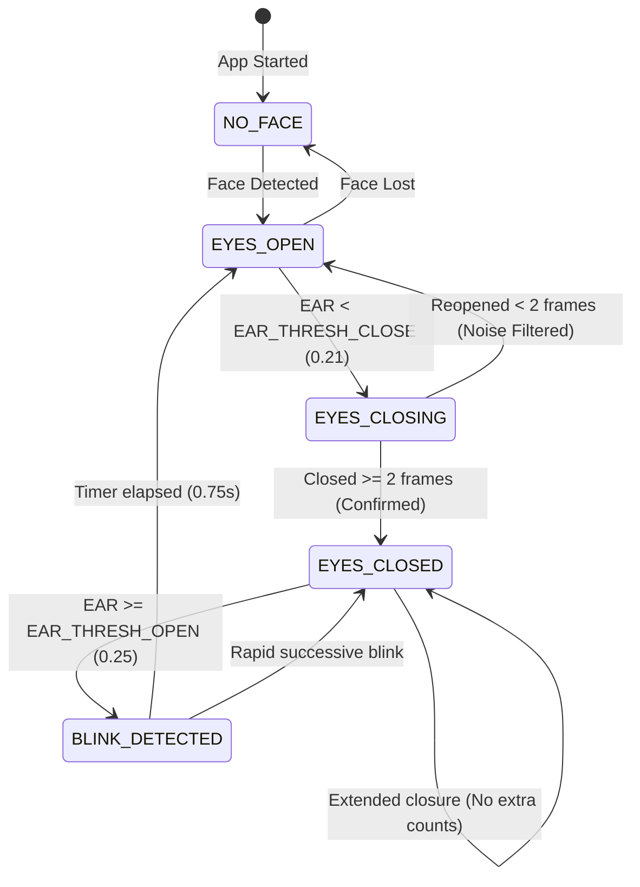

# Real-Time Eye Blink Detection & Counter Using Python

A robust, lightweight, standalone Computer Vision application built with **Python**, **OpenCV**, and **MediaPipe**. It detects a user's face and eyes via webcam in real time, computes the **Eye Aspect Ratio (EAR)** using 3D facial landmarks, and accurately counts complete natural blinks with temporal filtering and hysteresis.

---

## Key Features

- **Genuine Landmark-Based Detection**: Uses Google MediaPipe FaceLandmarker (478 3D landmarks) for high-precision eye tracking.
- **Accurate EAR Math**: Implements the classic Soukupová & Cech 6-point Eye Aspect Ratio formulation for both eyes.
- **Temporal State Machine & Hysteresis**:
  - Requires confirmed closure across consecutive frames to prevent noise spikes from triggering counts.
  - Dual-threshold hysteresis (`EAR_THRESH_CLOSE = 0.21`, `EAR_THRESH_OPEN = 0.25`) prevents rapid jitter near boundary states.
  - Prolonged eye closures (resting eyes, drowsiness) increment the counter exactly **once** upon reopening, never multiple times while closed.
  - Fast, natural blinks are tracked reliably without dropping frames.
- **Professional Minimal OpenCV UI**:
  - Real-time video stream with subtle, non-intrusive eye contour outlines and landmark dots.
  - High-contrast, semi-transparent Head-Up Display (HUD) showing **BLINKS: X** and live status.
  - Responsive status feedback:
    - `Face not detected — Look toward the camera`
    - `Status: Eyes Open`
    - `Status: Eyes Closed`
    - `Status: Blink Detected!`
  - Unobtrusive real-time FPS counter.
  - Optional real-time EAR debugging overlay (toggleable via `D` key).
- **CPU-Optimized**: Runs over 60–120 FPS on standard modern laptop CPUs without requiring a dedicated GPU.
- **Robust Error Handling**:
  - Automatic download and fallback verification for the MediaPipe model asset.
  - Graceful camera recovery and safe face lost/re-entry handling.
  - Zero terminal clutter: third-party C++ logs and warnings are neatly suppressed.

---

## Project Structure

```
CV-BlinkCounter-Project/
├── main.py                    # Application entry point and live video loop
├── requirements.txt           # Python package dependencies
├── README.md                  # Complete documentation and setup guide
├── .gitignore                 # Standard Python/IDE ignore rules
├── models/
│   └── face_landmarker.task  # Official MediaPipe FaceLandmarker model asset (~3.6 MB)
├── src/
│   ├── __init__.py
│   ├── face_detector.py       # Model initialization and landmark extraction
│   ├── blink_detector.py      # EAR calculation and temporal state machine
│   └── visualizer.py          # Professional OpenCV HUD and overlay rendering
├── config/
│   ├── __init__.py
│   └── settings.py            # Centralized thresholds, camera options, and UI palette
└── tests/
    ├── test_blink_counter.py  # Unit tests for state machine, EAR math, and edge cases
    └── test_full_pipeline.py  # Integration tests for all system components
```

---

## Algorithm & EAR Mathematics

### 1. Eye Aspect Ratio (EAR) Formulation

For each eye, six key anatomical landmarks are tracked:
- $p_1$: Outer corner (lateral canthus)
- $p_4$: Inner corner (medial canthus)
- $p_2, p_3$: Upper eyelid points
- $p_5, p_6$: Lower eyelid points

$$\text{EAR} = \frac{\|p_2 - p_6\| + \|p_3 - p_5\|}{2 \cdot \|p_1 - p_4\|}$$

```
           p2       p3
            ●───────●
       p1  /         \  p4
        ●             ●
           \         /
            ●───────●
           p6       p5
```

When an eye is open, the vertical distances $\|p_2 - p_6\|$ and $\|p_3 - p_5\|$ are large, resulting in an EAR between approximately $0.28$ and $0.38$. When an eye closes, the vertical distances rapidly approach zero while the horizontal distance $\|p_1 - p_4\|$ remains stable, causing the EAR to drop to $0.10 - 0.18$.

### 2. MediaPipe Landmark Indices

The canonical landmark indices from the MediaPipe Face Mesh model are:

| Feature | Right Eye (Viewer's Left) | Left Eye (Viewer's Right) |
| :--- | :--- | :--- |
| **Corner $p_1$** | `33` (outer) | `362` (inner) |
| **Upper Lid $p_2, p_3$** | `160`, `158` | `385`, `387` |
| **Corner $p_4$** | `133` (inner) | `263` (outer) |
| **Lower Lid $p_5, p_6$** | `153`, `144` | `373`, `380` |
| **Full Contour (16 pts)** | `33, 7, 163, 144, 145, 153, 154, 155, 133, 173, 157, 158, 159, 160, 161, 246` | `362, 382, 381, 380, 374, 373, 390, 249, 263, 466, 388, 387, 386, 385, 384, 398` |

### 3. State Machine & Hysteresis Logic



---

## Installation & Setup

### Prerequisites

- **Python**: Version 3.10 or 3.11 recommended.
- **Webcam**: Standard built-in laptop camera or USB webcam (`/dev/video0`).

### 1. Create a Virtual Environment

On Linux / macOS:
```bash
python3 -m venv .venv
source .venv/bin/activate
```

On Windows:
```cmd
python -m venv .venv
.venv\Scripts\activate
```

### 2. Install Dependencies

```bash
pip install -r requirements.txt
```

### 3. Model Asset (`face_landmarker.task`)

The application automatically verifies and downloads `face_landmarker.task` on first run if it is not already present.

If your environment has no internet access, download the official Google MediaPipe model manually:
- **Verified Download URL**: `https://storage.googleapis.com/mediapipe-models/face_landmarker/face_landmarker/float16/1/face_landmarker.task`
- **Destination**: Place the file into `models/face_landmarker.task`.

---

## Running the Application

Launch the program from the project root:

```bash
python main.py
```

### Expected Startup Output

```text
Initializing eye blink detector...
Loading facial landmark model...
Webcam initialized successfully.
Eye blink detection started. Press Q to quit.
```

The camera window will open, displaying the live webcam stream with real-time blink counter and status badges.

---

## Keyboard Controls

| Key | Action | Description |
| :---: | :---: | :--- |
| **`Q`** / **`ESC`** | **Quit** | Closes camera window and safely exits the application. |
| **`R`** | **Reset** | Resets the blink counter back to `0` without triggering a false blink. |
| **`F`** | **FullScreen** | Toggles between FullScreen immersion and standard windowed mode. |
| **`M`** | **Mirror View** | Toggles horizontal flip (natural mirror/selfie mode vs raw feed). |
| **`D`** | **Debug EAR** | Toggles real-time Left, Right, and Average EAR metrics on the HUD. |

---

## Command-Line Arguments

The application accepts optional CLI flags for flexible usage:

```bash
# Run in a standard window instead of FullScreen
python main.py --windowed

# Disable horizontal mirror flip
python main.py --no-mirror

# Run with a custom camera index (e.g. external USB webcam index 1)
python main.py --camera 1

# Start with debug EAR metrics enabled by default
python main.py --debug

# Run on a recorded video file instead of live webcam
python main.py --video path/to/recording.mp4

# Run for a specific number of frames (useful in automated tests)
python main.py --frames 100
```

---

## Calibration & Configuration

All detection thresholds and UI styling options are centralized in [`config/settings.py`](file:///home/vidit/Documents/Work/Projects/Minor%20Projects/CV-BlinkCounter-Project/config/settings.py):

| Parameter | Default | Purpose |
| :--- | :---: | :--- |
| `FULLSCREEN_DEFAULT` | `True` | Starts in clean, edge-to-edge FullScreen mode without Qt toolbars. |
| `MIRROR_VIEW` | `True` | Inverts left-right for a natural selfie/mirror experience. |
| `EAR_THRESH_CLOSE` | `0.21` | EAR value below which an eye is considered closed. |

| `EAR_THRESH_OPEN` | `0.25` | Hysteresis threshold to confirm eyes reopened. |
| `CONSECUTIVE_FRAMES_MIN` | `2` | Minimum consecutive closed frames to qualify as a blink (filters noise). |
| `CONSECUTIVE_FRAMES_MAX` | `45` | Upper limit for normal blinks before marking as prolonged closure. |
| `EAR_SMOOTHING_FACTOR` | `0.70` | Exponential moving average coefficient ($1.0$ = raw, $0.70$ = responsive smoothing). |
| `BLINK_STATUS_DURATION_SEC`| `0.75` | Duration (seconds) the `"Status: Blink Detected!"` message remains visible. |
| `CAMERA_INDEX` | `0` | Default hardware camera device index. |

---

## Running Automated Tests

A comprehensive unit and integration test suite is included in `tests/`:

```bash
python -m unittest discover -s tests
```

### Verified Test Cases:
1. **Model Initialization**: Verified MediaPipe FaceLandmarker load on CPU.
2. **Eyes Open Baseline**: Verified static open eyes maintain count at 0.
3. **Single Complete Blink**: Confirms transition open $\to$ closed $\to$ open increments count by 1.
4. **Multiple Sequential Blinks**: 5 complete independent blinks increment count to exactly 5.
5. **Noise Filtering**: Single-frame closure drops are filtered out by `CONSECUTIVE_FRAMES_MIN`.
6. **Prolonged Eye Closure**: Keeping eyes closed for 50+ frames does not trigger multiple counts; only 1 blink is registered upon reopening.
7. **Face Loss & Recovery**: Stepping out of frame clears incomplete blinks without false triggers; tracking recovers smoothly.
8. **Reset Behavior**: Pressing `R` sets count to 0 without triggering accidental blinks.
9. **Single-Eye Occlusion Fallback**: Evaluates single visible eye when the other is occluded.

---

## Troubleshooting & Known Limitations

- **Camera fails to open (`Could not open webcam index 0`)**:
  - Verify that another application (Zoom, browser, Teams, or another Python script) is not holding exclusive access to `/dev/video0`. Check active processes with `lsof /dev/video0`.
  - Try passing `--camera 1` if using an external USB webcam.
- **Eyeglasses / Reflections**:
  - Thick-framed glasses or harsh overhead lighting causing strong glare on lenses can occasionally reduce landmark tracking accuracy. Position the camera at eye level with indirect ambient lighting.
- **Low Ambient Lighting**:
  - Severe underexposure reduces edge contrast around eyelids. Ensure adequate forward-facing indoor lighting.
- **Extreme Head Poses**:
  - Profiles exceeding $\pm 45^\circ$ yaw will occlude one eye. The system gracefully falls back to the single visible eye, but frontal orientation is recommended for optimal accuracy.

---

## License

MIT License. Free for educational and commercial development.
